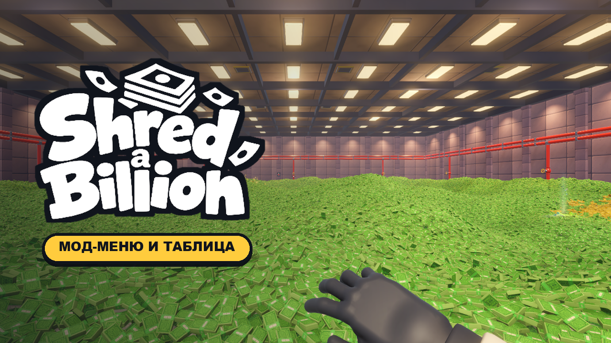
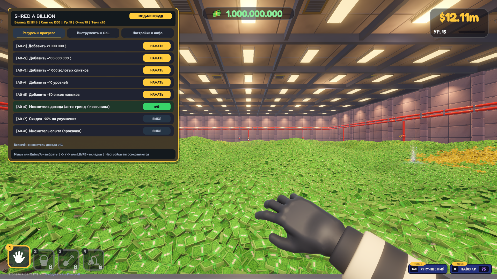

# SHRED A BILLION - Внутриигровое мод-меню, стартовое сохранение и таблица Cheat Engine (.CT)

Русское мод-меню прямо в игре (`v1.0`), стартовое сохранение с деньгами и таблица Cheat Engine для **SHRED A BILLION** (Steam AppID `5472080`, версия `1.0.23`, Windows и Steam Deck). Достижения в Steam не блокируются.

## Скачать
- **[Полное мод-меню v1.0 на Boosty (ранний доступ до 27 ноября, далее открыто всем)](https://boosty.to/cd_tixo/posts/91615b98-617b-4e4e-8056-baf6eca9ae71?utm_source=github&utm_medium=readme&utm_campaign=shred_a_billion)**
- **[Таблица .CT и стартовое сохранение на GitHub Releases](https://github.com/neoru-droid/shred-a-billion-mod-ru/releases)**

Поддерживаются **Windows 10 / 11** и **Steam Deck / Linux (Proton)**.

## Установка мод-меню
1. **Windows:** закройте игру, распакуйте архив и запустите `ShredABillion-Trainer-Setup.exe` -> **«Установить мод-меню»**.
2. **Steam Deck / Linux (Proton):** распакуйте архив и выполните `sh install-steamdeck.sh`, затем добавьте параметр запуска Steam: `WINEDLLOVERRIDES="winhttp=n,b" %command%`.
3. **Управление в игре:** клавиша `F1` или `F2` (либо `L3 + R3` на геймпаде) открывает оверлей; `Alt+1..8` запускают быстрые команды.

## Возможности внутриигрового мод-меню

### Вкладка «Ресурсы и прогресс»
- `Alt+1` - Добавить +1 000 000 $
- `Alt+2` - Добавить +100 000 000 $
- `Alt+3` - Добавить +1 000 золотых слитков
- `Alt+4` - Добавить +10 уровней
- `Alt+5` - Добавить +50 очков навыков
- `Alt+6` - Множитель дохода (`Выкл` / `x2` / `x10` / `x100`)
- `Alt+7` - Скидка `-95%` на все улучшения
- `Alt+8` - Множитель опыта (`Выкл` / `x2` / `x10` / `x100`)

### Вкладка «Инструменты и удобства»
- Открытие всех инструментов сразу (ведро, лопата, пылесос)
- Супер-магнит купюр на хранилище и вечные бустеры с автопродлением
- Ускорение времени игры (`x1.0` / `x1.5` / `x2.0`)
- Ускорение бега `x2.5`, режим полёта, сквозь стены (`Noclip`) и чистый экран без HUD

### Вкладка «Настройки и инфо»
- Автосохранение выбранных множителей и режимов между запусками игры
- Быстрый сброс переключателей и проверка обновлений на Boosty

## Таблица Cheat Engine (.CT) и стартовое сохранение
- В **GitHub Releases** лежат таблица `ShredABillion_RU_v1.0.CT` и стартовое сохранение `ShredABillion-Save-v1.0.zip` (`%USERPROFILE%\AppData\LocalLow\LightTriadGames\SHRED A BILLION\save.json`).

## Обратная связь и проекты автора

Заметили баг после патча игры - пишите в [Issues](https://github.com/neoru-droid/shred-a-billion-mod-ru/issues).

Все проекты автора: [сайт каталога](https://neoru-droid.github.io/) · [каталог на Boosty](https://boosty.to/cd_tixo/posts/2a55d7e9-0f53-4d93-9f66-280981158dec?utm_source=github&utm_medium=readme&utm_campaign=shred_a_billion) · [профиль на GitHub](https://github.com/neoru-droid)

Лицензия: [MIT](LICENSE)

Автор: `neoru-droid`
