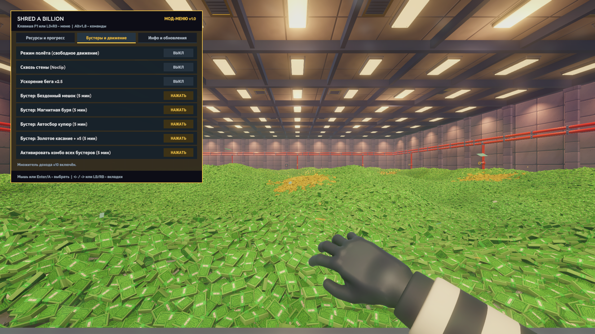

# SHRED A BILLION - Мод-меню, сохранение и таблица .CT

10 000 000 $ со старта, золотые слитки, очки навыков, все инструменты, магнит купюр и ускорение работы + таблица `.CT` (`v1.0`, версия `1.0.23`, Windows и Steam Deck).

## Скачать
- **[Скачать мод-меню v1.0 (ZIP)](https://github.com/neoru-droid/shred-a-billion-mod-ru/releases/download/v1.0.0/ShredABillion-Trainer-RU-v1.0.zip)** · [Таблица .CT и другие файлы на GitHub Releases](https://github.com/neoru-droid/shred-a-billion-mod-ru/releases)
- **[Страница игры и все архивы на Boosty](https://boosty.to/cd_tixo/posts/91615b98-617b-4e4e-8056-baf6eca9ae71)**
- **Ранний доступ и заказ своей игры:** новинки на 7 дней раньше (`120 ₽/мес на все релизы или разовый пост 150 ₽`), своя игра в очередь - `350 ₽`, разбор вне очереди - `750 ₽` на [Boosty](https://boosty.to/cd_tixo)

## Установка
1. **Windows:** закройте игру, распакуйте архив и запустите `ShredABillion-Trainer-Setup.exe` -> **«Установить мод-меню»**.
2. **Steam Deck / Linux (Proton):** распакуйте архив, выполните `sh install-steamdeck.sh` и добавьте в параметры запуска Steam: `WINEDLLOVERRIDES="winhttp=n,b" %command%`.
3. **В игре:** `F1` / `F2` или `L3 + R3` открывает окно, `Alt+1..8` запускают быстрые команды. Удаление - через тот же установщик.

## Функции мод-меню

- **Ресурсы и прогресс:** `Alt+1` `+1 000 000 $`, `Alt+2` `+100 000 000 $`, `Alt+3` `+1 000` золотых слитков, `Alt+4` `+10` уровней, `Alt+5` `+50` очков навыков, `Alt+6` множитель дохода (`x2 / x10 / x100`), `Alt+7` скидка `-95%`, `Alt+8` множитель опыта (`x2 / x10 / x100`).
- **Инструменты и режимы:** открыть ведро, лопату и пылесос, супер-магнит купюр, вечные бустеры, ускорение времени (`x1.5 / x2.0`), бег `x2.5`, полёт, `Noclip`, скрытие HUD и автосохранение настроек.

## Таблица .CT и стартовое сохранение
В **GitHub Releases** уже доступны таблица `ShredABillion_RU_v1.0.CT` и сохранение на `10 000 000 $` (`ShredABillion-Save-v1.0.zip` -> `%USERPROFILE%\AppData\LocalLow\LightTriadGames\SHRED A BILLION\save.json`).

Нашли баг после патча - пишите в [Issues](https://github.com/neoru-droid/shred-a-billion-mod-ru/issues).

[Сайт каталога](https://neoru-droid.github.io/) · [Каталог на Boosty](https://boosty.to/cd_tixo/posts/2a55d7e9-0f53-4d93-9f66-280981158dec) · [Telegram](https://t.me/neoru_droid) · [GitHub](https://github.com/neoru-droid) · [MIT](LICENSE) · Автор: `neoru-droid`
